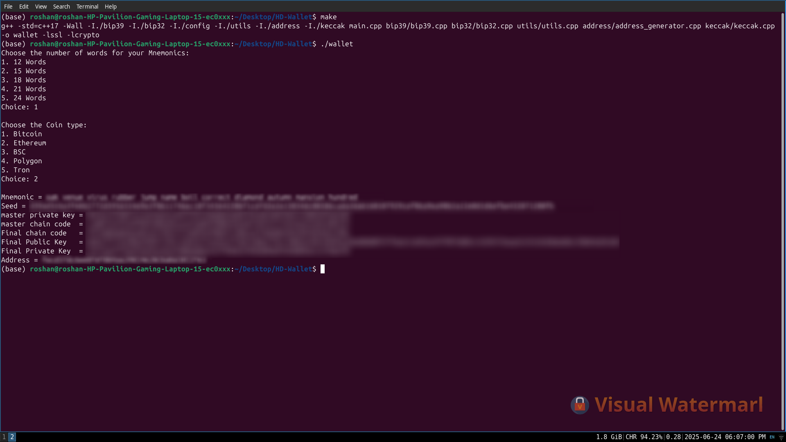

<h1 align="center">

</h1>

# HD Wallet
Easily generate secure cryptocurrency wallets with this modular, standards-compliant HD wallet engine built in C++. Whether you're learning how wallet internals work, building blockchain tools, or experimenting with key derivation and address formats, this CLI tool helps you create mnemonics, derive keys using BIP-32, and generate addresses with precision all with minimal dependencies and full control.

## Features
* Create secure wallet phrases of various lengths
* Generate a full set of keys from a single phrase
* Get both public and private keys instantly
* Create addresses compatible with multiple blockchain formats
* Select from different coin types at runtime
* Use the tool entirely from your terminal
* Designed to be fast, lightweight, and easy to extend

## Prerequisites
* A Linux environment (or WSL on Windows)
* A C++17-compatible compiler (e.g. `g++`)
* OpenSSL development libraries (`libssl-dev`)
* nlohmann‑json header‑only library (`nlohmann‑json3-dev`)
* CMake version 3.14 or higher

## Setup
1. Clone the repository and navigate into the project directory:
```bash
git clone https://github.com/Roshan-1024/HD-Wallet.git
cd HD-Wallet
```
2. Install dependencies (for Debian/Ubuntu/WSL):
```bash
sudo apt update
sudo apt install build-essential cmake libssl-dev nlohmann-json3-dev
```
3. Build the project:
```bash
mkdir build
cd build
cmake ..
cmake --build .
```
4. Run the executable:
```bash
./bin/wallet
```

## Running Unit Tests
To run the tests:
```bash
cd build
ctest
```
Or, run the test executable directly:
```bash
./bin/unit_tests
```

## Example Output
<h1 align="center">

</h1>  

## Standards Used
* [BIP-39: Mnemonic code for generating deterministic keys](https://github.com/bitcoin/bips/blob/master/bip-0039.mediawiki)  
* [BIP-32: Hierarchical Deterministic Wallets](https://github.com/bitcoin/bips/blob/master/bip-0032.mediawiki)  
